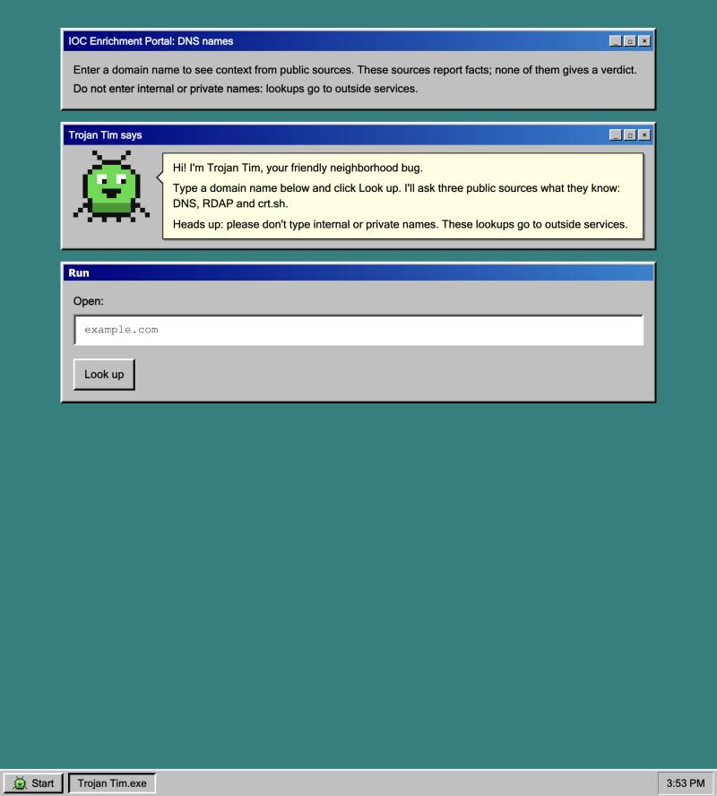
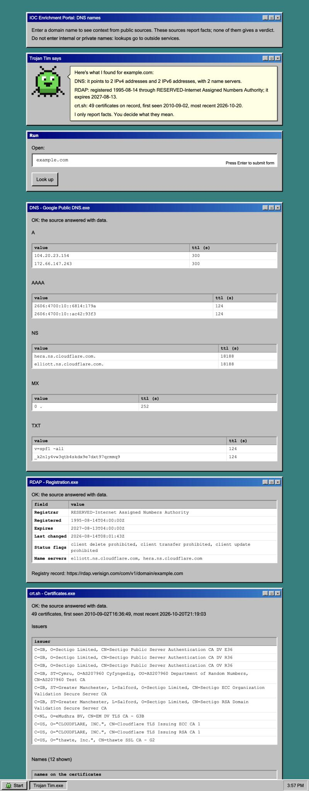
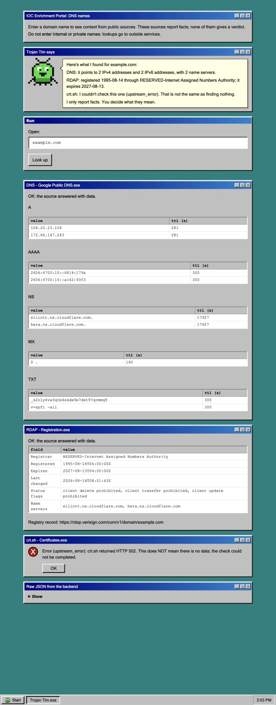
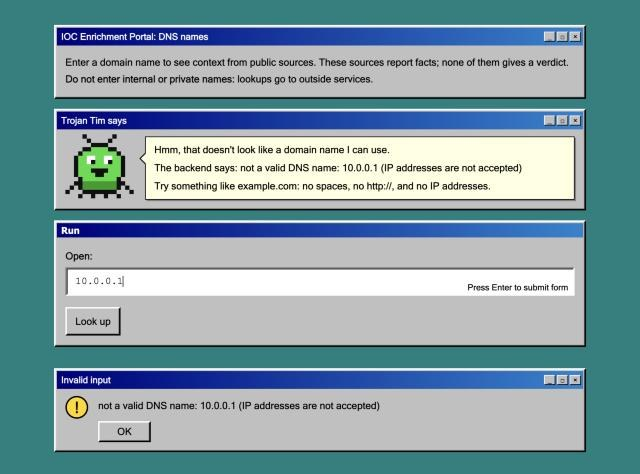
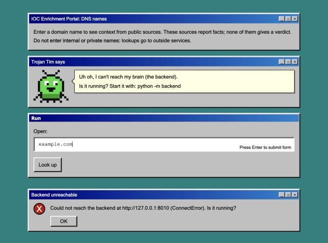
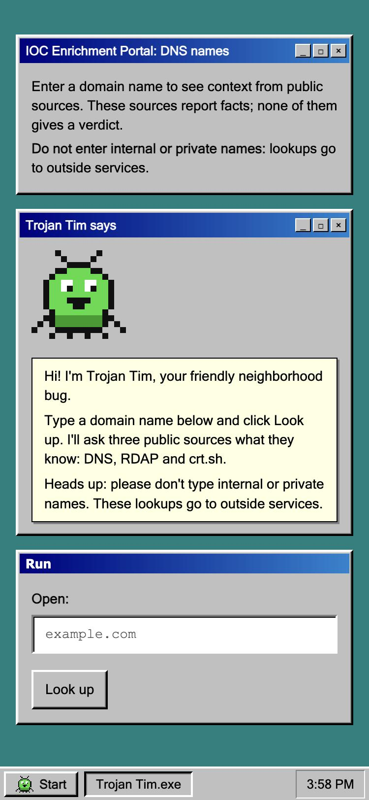

# IOC Enrichment Portal: DNS names

A SOC lookup tool: enter a DNS name and see enrichment from real, keyless public sources in one place.
Python only, with a **FastAPI backend** and a separate **Streamlit frontend** that talks only to the backend.

**Status: Milestone 2.** Three real, keyless sources in one response: Google Public DNS over HTTPS (where the name points),
RDAP (who registered it and when) and crt.sh (which TLS certificates were issued). If one source fails, the other two still return
and the failed one says what went wrong. Tests replay recorded real responses and run with the network off.
Plan, API contract and decisions: [`design.md`](design.md). Progress and evidence: [`docs/milestones.md`](docs/milestones.md).

> **Do not enter internal or private names** (`*.corp`, `*.local`, your company's own domains).
> Lookups go to outside services (Google). A privacy guard comes in a later milestone.
> None of these sources gives a verdict: they report facts, and you decide what they mean.

## Install

Requires Python 3.11+ (developed on 3.14). No Docker, no API keys.

```bash
git clone https://github.com/NewCooDooer/ioc-enrichment-portal-dns.git
cd ioc-enrichment-portal-dns
python3 -m venv .venv
source .venv/bin/activate          # Windows: .venv\Scripts\activate
pip install -r requirements-dev.txt
```

## Run

Start the backend (terminal 1):

```bash
python -m backend
```

Start the frontend (terminal 2):

```bash
streamlit run frontend/app.py --server.port "${FRONTEND_PORT:-8510}"
```

Open http://localhost:8510 and type a name such as `example.com`. Both parts listen on this computer only (`127.0.0.1`); 
the page's address is set in `.streamlit/config.toml` and the backend's in `BACKEND_HOST`. Change them only on purpose, because anyone who can reach the page can run lookups through your machine. The API itself is at http://127.0.0.1:8010
(interactive docs at `/docs`).

### Configuration (environment variables or a `.env` file; see `.env.example`)

| Variable | Default | Used by | Meaning |
|---|---|---|---|
| `BACKEND_HOST` | `127.0.0.1` | backend | address to listen on |
| `BACKEND_PORT` | `8010` | backend | port to listen on |
| `FRONTEND_PORT` | `8510` | frontend (`--server.port`) | port for the web page |
| `BACKEND_URL` | `http://127.0.0.1:8010` | frontend | where the frontend finds the backend |

Two portals on one laptop: give each its own ports, e.g. `BACKEND_PORT=8011 python -m backend` and
`BACKEND_URL=http://127.0.0.1:8011 streamlit run frontend/app.py --server.port 8511`.

## Try the API

```bash
curl -s http://127.0.0.1:8010/api/v1/domain/example.com      # 200, JSON with dns, rdap and crtsh
curl -s http://127.0.0.1:8010/api/v1/domain/10.0.0.1         # 400, {"error": ..., "input": ...}
curl -s http://127.0.0.1:8010/api/v1/health                  # {"status": "ok"}
```

Each source in the response has a `status`: `ok`, `not_found` (the source answered "nothing known") or
`error` (the check could not be completed; `error.code` and `error.message` say why). A failing source never changes the
HTTP status; only when **all** sources fail does the API return 502. See [`design.md`](design.md) section 4 for the full contract.

Notes: **crt.sh is slow (up to about a minute) and often returns HTTP 502**, so a lookup can take a while and its card shows an error some of
the time. RDAP "not found" can mean three things: the name does not exist, it is a subdomain (RDAP only covers registered domains, so
`login.example.com` normally shows "not found"), or its top-level domain is not covered by rdap.org (seen for `.de` and `.io`).

### See a source fail on purpose

Point one source at an address where nothing listens (the defaults are the real services):

```bash
CRTSH_URL=http://127.0.0.1:9/ python -m backend
curl -s http://127.0.0.1:8010/api/v1/domain/example.com   # dns and rdap ok, crtsh {"status":"error", ...}
```

## Test

```bash
python -m pytest
```

No API key and no network needed. The tests replay real responses recorded in `tests/fixtures/` (saved with
`python scripts/record_fixtures.py`, which stores only status, URL and body, never headers). `pytest-socket` makes any real
network call fail the test. To prove it at the operating-system level on macOS:

```bash
sandbox-exec -p '(version 1)(allow default)(deny network*)' python -m pytest -v
```

The suite covers a hit, an unknown name, a source error (a real recorded crt.sh 502), all-sources-failed (502), simulated timeout / 429 /
bad body, input validation and the frontend's backend client.

## What it looks like

The page is a Windows 95 desktop. **Trojan Tim**, a chipper pixel bug, tells you what to do and narrates results in plain language. He only reports facts (never a verdict), and when a source could not be checked he says so instead of implying there was nothing to find. The look is pure CSS with system fonts and one embedded image, so the page contacts no outside server.

| Welcome | All three sources |
|---|---|
|  |  |

| A source that failed (crt.sh 502) | Invalid input | Backend not running |
|---|---|---|
|  |  |  |

It also works on a phone-sized screen: 

## Layout

```
backend/app/   main.py (API), validation.py, models.py, service.py, config.py, sources/{doh,rdap,crtsh,common}.py
frontend/      app.py (page), client.py (calls the backend only), theme.py (Windows 95 CSS), mascot.py (Trojan Tim), render.py (escaped HTML)
.streamlit/    config.toml (theme colours, no usage stats)
tests/         test_*.py and fixtures/ (recorded real responses)
scripts/       record_fixtures.py (run by hand to re-record)
docs/          interview.md, milestones.md, screenshots/
```
