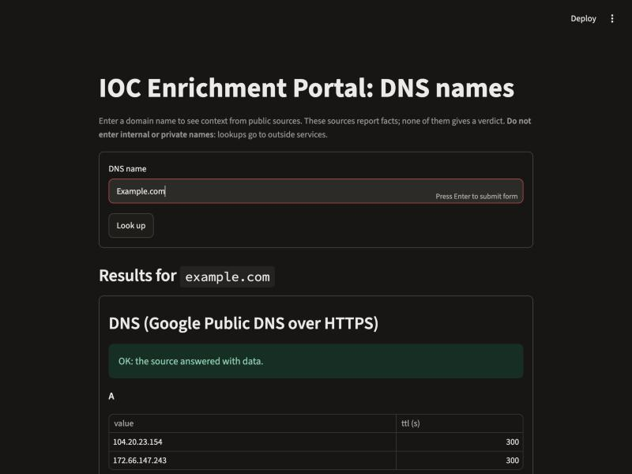

# Milestone log

Evidence for each milestone (commands, JSON, screenshots, pull requests). Updated as work lands.

## Milestone 0: design
- Status: done (merged via PR #1)
- Branch: `docs/design-md`
- Evidence: `design.md`, `docs/interview.md`; draft checked against the 8 required topics and project requirements in plan mode (2026-11-05)
- Pull request: #1 "Milestone 0: design.md for DNS-name IOC enrichment portal"

## Milestone 1: thinnest slice (Google DoH)
- Status: built and verified 2026-11-05; PR number filled in when opened
- Branch: `feat/milestone-1`
- Plan: written in plan mode from `design.md` and approved before any code
- Source: Google Public DNS over HTTPS (keyless). Python 3.14.7, FastAPI 0.162.0, Streamlit 1.67.0, httpx 0.28.1

### Definition of done (design.md section 8)
| Check | Result |
|---|---|
| Backend returns the source's data for a valid name, per the contract | ✔ request 1 below |
| Invalid input returns a clear error, not a crash | ✔ requests 2 and 3 below; no stack trace |
| Frontend shows the result for a typed name | ✔ screenshot below |
| README explains install and run for both parts | ✔ `README.md` |
| No key or token in any commit | ✔ none needed; `git grep` for key/token/secret/password finds only a comment in `.env.example` and docs text |
| Merged into `main` through a PR | see PR link at the bottom |

Also checked: ports are configurable (a second backend ran on `BACKEND_PORT=8011`); with the backend stopped, the frontend client
reports "Could not reach the backend at http://127.0.0.1:8010 (ConnectError). Is it running?"; `python -m pytest` runs 25 validation tests offline.

### 1. Real IOC: request and JSON returned
```
$ curl -s -i http://127.0.0.1:8010/api/v1/domain/example.com
HTTP/1.1 200 OK
content-type: application/json
```
```json
{
  "ioc": { "type": "domain", "input": "example.com", "value": "example.com" },
  "sources": {
    "dns": {
      "status": "ok",
      "data": {
        "resolver": "dns.google",
        "rcode": "NOERROR",
        "A":    [{ "value": "104.20.23.154", "ttl": 300 }, { "value": "172.66.147.243", "ttl": 300 }],
        "AAAA": [{ "value": "2606:4700:10::6814:179a", "ttl": 203 }, { "value": "2606:4700:10::ac42:93f3", "ttl": 203 }],
        "NS":   [{ "value": "elliott.ns.cloudflare.com.", "ttl": 21600 }, { "value": "hera.ns.cloudflare.com.", "ttl": 21600 }],
        "MX":   [{ "value": "0 .", "ttl": 14 }],
        "TXT":  [{ "value": "v=spf1 -all", "ttl": 300 }, { "value": "_k2n1y4vw3qtb4skdx9e7dxt97qrmmq9", "ttl": 300 }]
      }
    }
  }
}
```
(Whitespace reformatted for reading; values are exactly what the backend returned.)

### 2. Frontend screenshot, same IOC


### 3. Invalid IOC: request and response
```
$ curl -s -i http://127.0.0.1:8010/api/v1/domain/10.0.0.1
HTTP/1.1 400 Bad Request
{"error":"not a valid DNS name: 10.0.0.1 (IP addresses are not accepted)","input":"10.0.0.1"}

$ curl -s -i "http://127.0.0.1:8010/api/v1/domain/not%20a%20name"
HTTP/1.1 400 Bad Request
{"error":"not a valid DNS name: not a name (URLs, ports, e-mail addresses and spaces are not accepted)","input":"not a name"}
```
Also verified: a nonexistent name returns 200 with `"dns": {"status": "not_found", "data": null}`; an unknown route returns 404 `{"error":"not found"}`.

### Bugs found and fixed while building
- `"type": "domain"` was missing from `ioc` because `response_model_exclude_unset` dropped a default value; the service now sets it explicitly.

### Pull request
_filled in after the PR is opened_

## Milestone 2: three sources, recorded tests
- Status: not started
- Evidence to capture: JSON with all three sources; test output with network off; response with one failed source and how it was forced; PR title and number
